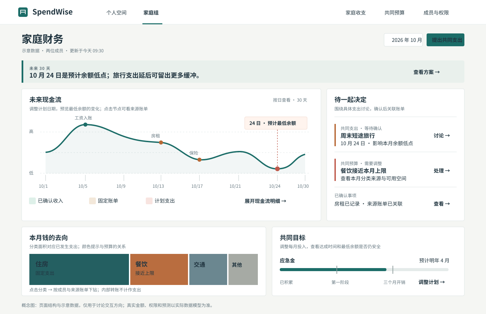

# SpendWise 用户中心与家庭组｜精简设计稿

> 目标：在保留个人财务工作台的基础上，让组长查看成员授权范围内的收支，并建立口径可信的家庭财务驾驶台。本稿是设计基线；实际交付、验证和剩余限制见 [README](README.md) 与 [功能验收记录](FEATURE_PARITY.md)。

## 1. 先建立用户中心

重构前的 SpendWise 没有登录、用户归属或家庭权限，账本和设置均为全局数据。因此先让账单、预算、账户、导入任务、分类规则、AI 会话和授权归属于具体用户，再通过本机一次性认领把现有数据安全地归到指定账号。

右上角头像进入**用户中心**，只放四类事情：

| 页面 | 用户要完成的事 |
| --- | --- |
| 个人资料与安全 | 注册/登录、验证身份、重置密码、管理登录设备 |
| 我的家庭 | 创建家庭、接受邀请、查看成员、退出；leader 可邀请/移除成员、转让 leader、解散家庭 |
| 数据共享 | 查看“谁能看我的哪些数据”、共享起始日期和资产纳入范围；退出后立即停止新的读取 |
| 数据管理 | 导出个人数据、处理账号注销；原有预算和 AI 连接仍放在“设置” |

## 2. 页面组织与家庭体验

顶栏设置清晰的 **「个人空间 / 家庭组」切换**，切换后导航和指标一起改变，避免把个人预算余额误读为家庭余额。未加入家庭的用户看到创建/接受邀请入口。

```text
个人空间：概览｜消费模拟｜账本｜账户与资产｜导入｜设置    头像→用户中心
家庭组：  家庭财务驾驶台｜家庭议事板｜家庭收支｜共同预算｜成员与权限

家庭财务驾驶台（leader）
┌ 未来 30 天现金流跑道（约 2/3） ─┬─ 本周待处理（约 1/3） ┐
│ 收入/账单事件、低余额日期、方案前后 │ 共担账单、预算风险、待议计划 │
├ 共同支出结构：面积看金额、颜色看预算偏差 ─┬─ 共同目标进度 ┤
└ 成员收支来源：按成员展开只读账单；覆盖范围和更新时间常驻 ┘
```



*概念图使用示意数据，只表达信息层级和交互关系，不代表产品计算结果。*

这里的重点是“家庭接下来要做什么决定”，不把四个数字、两张图和成员排行榜堆成首页。

| 家庭要回答的问题 | 视觉形式 | 点击或调整后的动作 |
| --- | --- | --- |
| 这个月能否安排一笔共同开支？ | **现金流跑道**：日期轴上标收入、待付账单和预计余额区间，标出最低点 | 调整拟支出金额或日期，立即对比“原计划/新方案”；点事件查看来源账单。账户余额、预算剩余分别标注，不能混称“可花的钱” |
| 哪项家庭开支正在偏离计划？ | **共同支出矩形图**：面积代表已发生金额，颜色代表相对该分类预算的偏差；旁边保留可读的金额列表 | 点分类进入该分类的家庭共担账单，再按月份或成员筛选；无分类预算时只显示金额，不套“超支”颜色 |
| 旅行、应急金等目标还差多远？ | **目标进度轨道**：目标金额、当前已留存、计划完成时间及缺口并列 | 把一笔待议支出加入/移出方案，查看目标日期会否变化；目标余额必须有明确账户或手动记录来源 |
| 谁录入了哪些共担支出？ | **成员来源列**：按成员展示共担金额与授权范围，不按“谁花得多”排名 | leader 展开只读账单并核对归属；成员只见自己的明细和已发布的家庭摘要 |

**家庭议事板**让成员共同规划，而不只让 leader 观察：成员提出计划支出（金额、日期、用途、分担方式）→系统展示对共同预算和现金流的影响→成员讨论→leader 确认或退回→实际入账时关联原账单。可将待议卡片拖到现金流日期轴，或用日期控件调整计划日期；浅色线保留原计划，实色线展示新方案，同时对比最低余额和目标达成日期。卡片状态和方案差异比大段说明更直观；确认只保存计划，不生成真实支出，实际账单入账后关联计划并防止重复统计。此处可复用个人空间已有的消费模拟与方案比较能力，但家庭计划须单独保存和授权。

新增的“账户与资产”页记录资产、负债、余额及估值日期，并标明个人或共有归属、是否计入家庭；它是净资产的数据来源，不替代收支账本。仅当参与统计的账户、资产和负债录入清单完整，且每项估值都在用户设定的有效期内，才展示“家庭净资产”；否则只显示已覆盖的资产与负债，并醒目标出未覆盖范围，不推算全家净资产。成员端只看自己的账本、自己提交的家庭共担支出及 leader 发布的家庭计划；**精确的家庭财富总额默认仅 leader 可见**，否则少人数家庭可通过总额或筛选反推出他人的私账。

设计参照：

- [Monarch Money 的报表与周期账单](https://www.monarchmoney.com/features/recurring)：资金流向支持下钻，账单日历提示即将发生的支出；借鉴“看趋势→看日期→查原账单”的路径。
- [Goodbudget 的信封预算](https://goodbudget.com/)：用可见的分类额度帮助家庭理解“哪笔钱已分配”；借鉴共同预算的余额感，保留 SpendWise 对账户余额与预算余额的区分。
- [Copilot Money 的目标进度](https://help.copilot.money/en/articles/11470324-savings-goal-tab-overview)：目标、投入和进度放在一起；借鉴目标轨道，使家庭能看到一项提案对达成时间的影响。

## 3. 权限与加入流程

| 能力 | Leader | 成员 |
| --- | --- | --- |
| 本人的账单、预算、AI 密钥和对话 | 管理 | 管理 |
| 其他成员的收支与来源账单 | 按已同意的范围只读 | 不可见 |
| 家庭财务驾驶台、共同预算 | 查看全貌并管理共同预算 | 仅看被发布的摘要，登记自己的共担支出 |
| 其他人的私账修改/删除 | 不可 | 不可 |
| 邀请、移除、转让 leader、解散 | 可 | 仅可退出 |

流程为 **创建家庭 → 邀请 → 成员确认共享范围 → 加入 → 持续查看/调整 → 退出或移除**。成员接受邀请时明确告知 leader 可查看其收支明细；默认共享**加入日起**的数据，分享既有历史需成员主动选择。账户余额、资产和负债另行按账户选择是否纳入家庭财富；加入家庭不自动开放 AI 账本授权。退出/移除后 leader 立即失去该成员私账的访问权，成员自己的数据仍归本人。

## 4. 家庭统计口径

- **家庭现金流**：合并已共享成员的对外收入和净支出；家庭成员之间转账、报销不重复计为收入或支出。共同预算只统计标记为“家庭共担”的支出，个人预算继续独立计算。
- **家庭净资产**：纳入的资产余额减负债余额，显示估值日期、参与成员和账户覆盖情况；共同账户只计一次。现有 demo 只有交易和推算余额，尚不能把“收入减支出”称作财富或净资产，必须补资产/负债账户及余额快照。
- **账单归属**：原账单仍归录入者；标记家庭共担只改变统计范围，不复制交易。leader 下钻查看时只能读，不能改成员私账。

## 5. 设计验收

1. 老用户升级后，原账单与设置完整归属自己的账号；不同账号不能相互读取。
2. 成员接受邀请前看清共享起点与范围；leader 能筛选成员收支和来源账单，不能修改它们。
3. 家庭现金流、共同预算、净资产各有不同口径与来源下钻；缺少资产数据时显示“未覆盖”，不伪造净资产。
4. 退出、移除、转让 leader 后，页面和接口权限同时生效；个人数据和私有 AI 内容不随家庭转移。

**参考**：[Monarch 家庭协作](https://help.monarch.com/hc/en-us/articles/20926382202004-Monarch-for-Couples-and-Households)展示独立登录与家庭总览；[Monarch Shared Views](https://help.monarch.com/hc/en-us/articles/42228648365076-Shared-Views-in-Monarch)展示个人/共同归属筛选，但其筛选不等于隐私权限；[YNAB Together](https://support.ynab.com/en_us/ynab-together-B1nS78Cki)展示 leader 邀请与共享关系。本方案采用 leader 只读私账和加入时明确授权，避免直接照搬产品权限。
